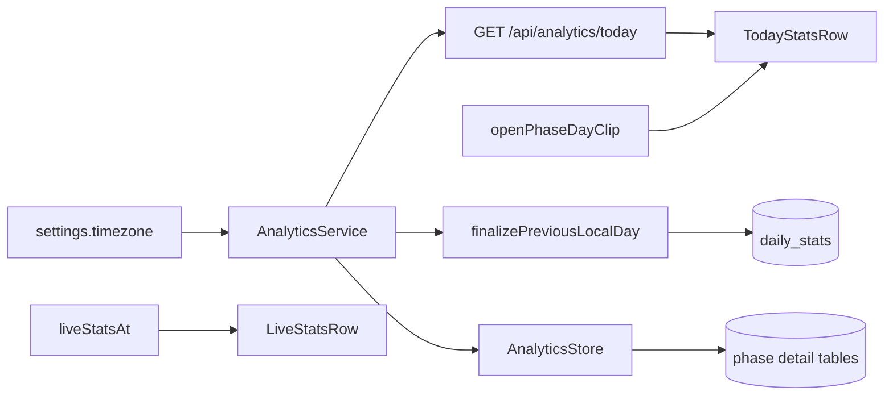

# M3.5 – Idle today stats

Sources: [docs/product/PRD.md](docs/product/PRD.md) §4.8 (FR-AN-9, FR-AN-4 exclusions), §6.2 idle surface; Notion FPMD-20 (referenced from M3). Prerequisite: [M3 persistence & resume](.cursor/plans/m3_persistence_resume.plan.md) is complete — closed detail rows already exist in SQLite.

## Current gap

- Idle UI ([`IdleStartForm`](apps/web/src/components/timer/IdleStartForm.tsx)) shows Ready + overrides only; no day totals.
- [`PhasesStore`](apps/server/src/db/stores/phasesStore.ts) lists per-session rows only; no day-range aggregation or daily rollups.
- No public analytics API; no timezone on [`Settings`](packages/shared/src/index.ts).
- Active HUD has session-scoped `LiveStatsRow` only ([`ActiveTimer.tsx`](apps/web/src/components/timer/ActiveTimer.tsx)).

## Scope

**In (FR-AN-9 / PRD M3.5):**

- Persist **`timezone`** (IANA) on settings; seed from the browser on first settings hydrate; editable on Settings
- Server derives the analytics local day from that timezone (**no `dayStart`/`dayEnd` query params**)
- Overlap-clipped aggregates for the open day (worked, deliberation, rest, paused)
- **`daily_stats` table**: at local midnight in `settings.timezone`, finalize the previous day so M4 can sum past days without re-clipping phases
- `GET /api/analytics/today` returns open-day totals so far
- **Separate Today stats row** on idle and active; live session stats (FR-AN-8) unchanged
- While active: `todayDisplay = serverTodayClosedSoFar + openPhaseProgressClippedToDay`
- Unit tests + manual smoke

**Out:**

- Analytics tab / charts / multi-day filters (M4) — reads `daily_stats` + open-day path
- Changing live-session stats semantics
- Rebuilding `daily_stats` when the user later changes timezone

## Timezone (locked)

- Field: `settings.timezone` (IANA string, e.g. `Asia/Kolkata`)
- **Seed:** on first successful settings load in the web app, if the stored value is still the install default, `PUT` `Intl.DateTimeFormat().resolvedOptions().timeZone`
- **Edit:** Settings tab control (text or select of common zones; validate IANA on server)
- Default in [`DEFAULT_SETTINGS`](packages/shared/src/index.ts) / DB seed: `"UTC"` until the browser seed runs
- Migration adds `timezone` column to `settings` with default `'UTC'`

## Day bounds and attribution (locked)

Server computes `[dayStart, dayEnd)` for “today” (and for the day being finalized) in `settings.timezone` (client timezone) using Luxon.

For each closed row that overlaps the window:

```text
overlapStart = max(startedAt, dayStart)
overlapEnd   = min(endedAt, dayEnd)
overlapSec   = max(0, floor((overlapEnd - overlapStart) / 1000))
```

| Bucket | Source | Day contribution |
| --- | --- | --- |
| `workedSec` | closed `planned_work` + `extended_work` | planned_work: clipped wall minus clipped pause from overlapping `pause_slices` (do not scale whole-row `pausedSec`); extended: clipped wall |
| `deliberationSec` | closed `decision` + `short_rest_ack` | clipped wall; timeout-deleted decisions absent (FR-FLOW-11) |
| `restSec` | closed `rest` | clipped wall |
| `pausedSec` | closed `pause_slices` | clipped wall per slice |

Wire shape: `TodayStats` alias of `SessionLiveStats`.

## `daily_stats` (locked)

Purpose: materialize **completed** client-timezone days so M4 does not re-aggregate phase history for every past day. The open day is still computed on demand.

Suggested row shape:

- `clientDate` (PK) — `YYYY-MM-DD` in `settings.timezone` (client timezone)
- `dayStart` / `dayEnd` — ISO instants used when the row was written
- `workedSec`, `deliberationSec`, `restSec`, `pausedSec`
- `finalizedAt`

**Finalize:** when the scheduler (or analytics path) observes that the local date in `settings.timezone` has advanced past the last finalized date, aggregate that previous day from closed phases (overlap clip) and upsert `daily_stats`. Idempotent. Also run once at boot to catch up missed midnights while the process was down.

Open-day `GET /api/analytics/today` aggregates closed phases overlapping today (does not require a `daily_stats` row for today).

## Today display while active (locked)

```text
todayDisplay = serverToday (closed overlap for today)
             + openPhaseProgressClippedToDay(phase, dayStart, dayEnd, nowMs)
```

- Live session row unchanged
- Today is a second row (label “Today”)
- Refetch today on phase transitions, idle remount, window focus
- Day roll: server midnight finalize + client refetch when `serverNow` / poll crosses the new local date; open-phase clip uses the new day’s bounds
- Idle: today = server today only



## Execution order

### 1. Timezone on settings

**Files:** [`packages/shared/src/index.ts`](packages/shared/src/index.ts), settings migration, [`settingsStore.ts`](apps/server/src/db/stores/settingsStore.ts), [`SettingsTab.tsx`](apps/web/src/components/SettingsTab.tsx), settings query/hydrate path

- Extend `SettingsSchema` / `DEFAULT_SETTINGS` with `timezone: string` (default `"UTC"`)
- Knex migration: `settings.timezone` not null default `'UTC'`
- Web: after first settings fetch, if value is still default `UTC` **and** browser zone differs, persist browser zone once (avoid fighting an intentional UTC user: only auto-seed when row was never customized — use a one-shot flag or “seed if timezone still UTC and `updatedAt` equals install seed” is brittle; prefer: auto-seed only when settings were just seeded / first visit via a `timezoneSeeded` boolean column **or** seed whenever stored is `UTC` and browser is not `UTC` on first app session only via `localStorage` gate `flexi-pomodoro:tzSeeded`)
- **Chosen seed gate:** `localStorage` key `flexi-pomodoro:tzSeeded` — first load writes browser IANA via settings PUT, sets the key; later UTC choice is respected
- Settings UI: show/edit timezone

### 2. Shared analytics API

**File:** [`packages/shared/src/index.ts`](packages/shared/src/index.ts)

- `ANALYTICS_API.today: "/api/analytics/today"`
- `TodayStats` alias of `SessionLiveStats`
- No day-bound query schema

### 3. Analytics store + service + migration

**New:** `apps/server/src/db/stores/analyticsStore.ts`, `apps/server/src/services/analytics.service.ts`, migration for `daily_stats`

- `AnalyticsStore` — DB queries only (closed overlapping phase lists, `daily_stats` upsert/get)
- `AnalyticsService.dayStats(clientDate)` — client-day bounds (Luxon) + overlap-clip aggregate; reuses bound ms
- `AnalyticsService.todayStats()` — thin wrapper: `dayStats` for today’s client date
- `upsertDailyStats(row)` / `getLatestFinalizedClientDate()` / `getDailyStats(clientDate)`
- `AnalyticsService.finalizeDueDays()` — catch up missing finalized client dates through yesterday via `dayStats`
- Day bounds via Luxon (`clientDay` helpers); wire into `createStores` / `RouteDeps`; keep out of `SessionService`

### 4. Route

**New:** `apps/server/src/routes/analytics.routes.ts`

- `GET /api/analytics/today` → 200 `TodayStats` (zeros if empty)
- Register from [`routes/index.ts`](apps/server/src/routes/index.ts)

### 5. Midnight finalize

Hook `finalizeDueDays` into the existing interval scheduler path in [`app.ts`](apps/server/src/app.ts) (same ~250ms tick is fine: compare local date string, run finalize only on change / missing days). Also call once after boot hydrate.

### 6. Today UI

**Files:** [`IdleStartForm.tsx`](apps/web/src/components/timer/IdleStartForm.tsx), [`ActiveTimer.tsx`](apps/web/src/components/timer/ActiveTimer.tsx), [`timerDisplay.ts`](apps/web/src/components/timer/timerDisplay.ts), `apps/web/src/utils/todayStats.ts`, `apps/web/src/queries/analytics.api.ts` + `useTodayStatsQuery`

- Keep **LiveStatsRow** session-scoped
- Add **TodayStatsRow** below Start (idle) and below live stats (active)
- Client open-phase clip needs today’s `[dayStart, dayEnd)` — obtain from response metadata or a tiny companion field on the today payload: include `dayStart` / `dayEnd` / `clientDate` on the today response so the client clips without re-deriving TZ
- **Chosen response shape:** `{ clientDate, dayStart, dayEnd, workedSec, deliberationSec, restSec, pausedSec }`
- Invalidate/refetch on phase change, mutations, focus, idle remount

### 7. About copy

**File:** [`apps/web/src/constants/about.ts`](apps/web/src/constants/about.ts)

- Persistence → `available`; add Idle today stats `available`

### 8. Tests + smoke

| Case | Expect |
| --- | --- |
| Empty day | zeros |
| Phase fully inside day | full buckets |
| Phase spanning local midnight | only overlapping seconds per day; finalize writes yesterday correctly |
| Pause slice spanning midnight | clipped via slices, not scaled `pausedSec` |
| `finalizeDueDays` after downtime | backfills missing `daily_stats` rows |
| Today endpoint ignores client query params | uses settings timezone only |
| Browser tz seed once | first visit persists browser zone; second visit does not overwrite |

**Manual:** idle Today after a completed session; active shows live + Today; phase complete no double-count; Analytics tab still stub.

## Key design decisions

- **Server-owned timezone** — analytics day bounds and midnight finalize use `settings.timezone`; browser seeds once, then Settings owns the value.
- **No day query params** — `GET /api/analytics/today` is timezone-authoritative; response includes `dayStart`/`dayEnd` for client open-phase clip.
- **`daily_stats` for completed days** — M4 sums this table; open day stays on-demand aggregate.
- **Overlap clipping** — only seconds inside the local day count.
- **Separate Today row** — live session stats unchanged.
- **Today while active = server today + open-phase day clip** — no adding full `liveStats`.
- **`AnalyticsService` / `ANALYTICS_API`** — M3.5 is the first analytics slice; M4 extends it.
