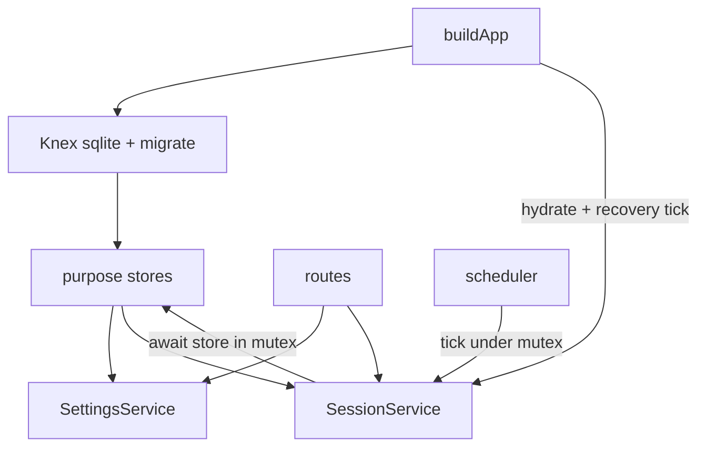

# M3 – Persistence & resume

Sources: [docs/product/PRD.md](docs/product/PRD.md) §4.1 (FR-HOST-2), §4.5 (FR-FLOW-10/11), §4.7.3 (FR-ACK-6), §7.3 segments, §11 / Q9 S1–S8; Notion [FPMD-19](https://app.notion.com/p/3b8c8329801e8194b89ef2b4bc42bdc8) (+ [FPMD-2](https://app.notion.com/p/3b8c8329801e81079c19d683f027921f)). Prerequisite: M2.5 (SHORT_REST_ACK + live stats + FR-FLOW-11 counter rules) is already in [`session.service.ts`](apps/server/src/services/session.service.ts).

**Why async + Knex now:** Alpha still ships SQLite on a volume (roadmap M3). Post-v1 considered path includes cloud-hosted SaaS, where SQLite is a poor fit and Postgres (or similar) is expected. Making the engine async and putting Knex under purpose-split stores avoids a later engine rewrite when that path lands. Postgres itself is **out of M3 scope**.

## Current gap

- Settings and session are in-memory only ([`SettingsService`](apps/server/src/services/settings.service.ts), [`SessionService`](apps/server/src/services/session.service.ts)); restart loses everything.
- `/data` is mounted in Compose/Dockerfile but unused ([`docs/data-model.md`](docs/data-model.md)).
- Engine `tick` / commands are **sync**; scheduler fires sync `onTick`.
- `getSnapshot` currently calls `tick` (side effect on GET / SSE open).
- In-process `tick` already walks due boundaries; there is **no** hydrate-from-disk + catch-up after downtime, no phase history rows, no `endedReason: "recovery"`.
- Runtime still runs as root (FPMD-2). Existing alpha volumes under `/data` are root-owned (often empty).

## Scope

**In (FPMD-19 / PRD M3):**

- Async session engine + serial mutex on every path that calls `tick`
- Pure `getSnapshot` (no tick); GET `/api/session` and SSE open are read-only
- FR-HOST-2: SQLite under `/data` via Knex + `better-sqlite3`; settings + active session + phase history survive recreate
- Labeled phase/segment shapes per PRD §7.3 (class-table `phases` + detail tables)
- FR-FLOW-11 / FR-ACK-6 attribution on write (not only liveStats)
- Boot recovery: hydrate (including `alertSeq`) → `await tick(now, { recovery: true })` → closes in that tick use `endedReason: "recovery"`; cover Q9 S1–S8 including SHORT_REST_ACK
- FPMD-2: non-root `USER node`; fresh `/data` node-owned; alpha upgrade documents deleting empty root-owned volumes
- Unit/integration tests for segment attribution + S1–S8 recovery

**Out:**

- Idle today UI aggregates (M3.5 / FPMD-20)
- Analytics dashboard (M4)
- Postgres / SaaS / multi-user (post-v1 considered; Knex dialect swap later)
- CSV / backup / rich migration tooling (Beta → Stable) — ship minimal Knex migrations only
- Web UI changes (resume is transparent via existing snapshot/SSE)
- Docker entrypoint that chowns `/data` at runtime (alpha: operators delete empty root-owned volumes instead)

## Technical approach

**Stack (chosen):**

- **Knex** — shared SQL / dialect layer. Purpose-split stores call Knex; they do not import the SQLite driver. Later Postgres = new Knex client config, same stores.
- **`better-sqlite3`** — Knex SQLite client for alpha self-host (still the strong default under Knex; async app API comes from Knex wrapping sync calls).
- **Purpose-split stores** — e.g. settings / session / phases (maintainability). Feature, not a bug. No per-DB store interfaces; one Knex instance injected into each store.
- **Async engine** — `tick` and commands `await` store writes inside a **serial mutex**. Every caller of `tick` takes that lock: commands, scheduler, and the one boot recovery tick. Scheduler must not overlap ticks (skip-if-busy or await previous).

**Seam:**



- [`buildApp`](apps/server/src/app.ts): open Knex (`DATA_DIR` / default `/data` in Docker, local `./data` in dev) → migrate → construct stores → inject into settings + session → hydrate → one `await tick(Date.now(), { recovery: true })` before scheduler starts.
- **Write-through:** every command and every `advanceOnce` transition that opens/closes a phase `await`s store work (in a transaction when multiple rows) before `notify()`. Idempotent closes (same phase id). Every phase end sets `endedAt` and the outcome / `endedReason` on that detail row before opening the next phase (or finalizing the session).
- **Phase model:** parent table `phases (id, kind)` plus one detail table per kind. `phases.kind` is the **only** source of truth for phase type, including `short_rest` \| `long_rest` (no `kind` column on `rest`). On phase start: insert `phases` and the matching detail row (`endedAt` null). On phase end: update that detail row (`endedAt`, outcome / `endedReason`). No second history store and no phase JSON blob. `session_runtime.currentPhaseId` FK → `phases.id`. Locked session params are columns on `sessions`. liveStats and `alertSeq` are columns on `session_runtime`.
- **Settings:** singleton row with one column per settings field; load into `SettingsService`, persist on `update`.
- **Snapshot vs tick:** `getSnapshot` / SSE open only build from current in-memory state (no `tick`). Wall-clock catch-up is owned by the scheduler (~250ms), commands (`beginActiveCommand`), and boot recovery. Up to one scheduler interval of staleness on a pure GET is acceptable. Engine tests that advance time call `tick` then `getSnapshot`.

**Pause persistence (normative):**

Pause plugins stay **sync** and only mutate the in-memory `PlannedWorkPhase` (FR-PAUSE-M1/M2). Do **not** inject stores into pause modules.

Around each plugin call (`onPause` / `onResume` / `onPlannedEnd`), the engine (or a small helper) snapshots pause fields, runs the plugin, diffs before/after, and persists:

- `pause_slices` open/close (FK to planned-work phase id)
- planned-work columns: `paused`, `pauseStartedAt`, `timerFrozenAt`, `pausedSec`, and on hard resume the shifted `plannedEndAt`

Those writes share the **same transaction** as any surrounding phase transition (e.g. soft auto-rest at planned end closes the slice, completes planned work, and opens rest together).

**Phase write rules (normative):**

| Event | Persist |
| --- | --- |
| Enter planned work | Insert `phases` + `planned_work` (open) |
| Planned work ends (focusing) | Complete planned work (`planned_complete`); insert `phases` + `decision` (open) |
| Soft-paused auto-rest | Complete planned work (`soft_paused_auto_rest`); **no** decision row; insert `phases` + `rest` (open); pause slice closed in same trx |
| Explicit ack / continue | Complete `decision` (`ack_rest` \| `continue`); open rest or extended. Continue: extended `startedAt` = click. |
| Decision timeout | In one transaction: insert `phases` + `extended_work` (`startedAt` = decision start); update `session_runtime.currentPhaseId`; **delete** `decision` detail row; **delete** old `phases` row (FR-FLOW-11: no decision history on timeout) |
| Short rest ends | Complete `rest` (`completed`); insert `phases` + `short_rest_ack` (open) |
| Short-rest ack ack/timeout | Complete `short_rest_ack` (`acknowledged` \| `timeout_paused`); open next planned work (timeout path may open a pause slice via plugin diff) |
| Start rest from extended | Complete extended (`user_start_rest`); open rest |
| Long rest ends (timer) | Complete `rest` (`completed`); finalize session; clear `session_runtime` |
| Early end long rest | Complete `rest` (`long_rest_skipped_early`, `actualDurationSec` = start→click); finalize session; clear `session_runtime` |
| Soft/hard pause open/close | Via plugin diff: `pause_slices` + planned-work pause columns (see above) |
| Recovery catch-up closes | Same completes/opens as live rules, but any phase **closed** during the boot recovery tick uses `endedReason: "recovery"` where the detail table has that column |

Keep engine policy in `SessionService`; stores only persistence. Prefer a small internal helper called from existing transition sites so FR-FLOW-11 does not fork a second attribution path.

**Recovery:**

1. If `session_runtime` exists, load it (including `alertSeq`) into the service **before** any catch-up tick.
2. Resolve `currentPhaseId` → `phases.kind` → detail row; rebuild `ActiveSession` + pause plugin from `pauseStrategy`. Soft-pause downtime across restart works once `pauseStartedAt` (and other pause columns) are restored on the open planned-work row.
3. `await tick(Date.now(), { recovery: true })` once under the mutex. Recovery is an **explicit boot flag**, not inferred from wall-clock skew. Phases closed in that tick get `endedReason: "recovery"` where applicable. Later scheduler/command ticks use normal reasons.
4. Persist `alertSeq` whenever it advances during a live session (same as liveStats).

Alerts emitted during recovery: keep existing `pendingAlerts` behavior (clients that reconnect get deltas from watermark — acceptable for alpha).

**Docker (FPMD-2):**

- Runtime stage: `RUN mkdir -p /data && chown node:node /data`, then `USER node`, so **new** named volumes inherit node ownership.
- Alpha upgrade: operators with an existing **empty root-owned** `/data` volume delete that volume (or data dir) once before pulling the M3 image. No runtime chown entrypoint.
- Confirm `better-sqlite3` native install and process UID ≠ 0 in smoke.

## Schema (initial migration)

Tables aligned to PRD §7.3 (separate work shapes; no single `WorkSegment` kind flag for policy). Prefer real columns over JSON for fixed flat shapes. Migrations via Knex.

**Phase identity (class-table):**

- `phases` — `id` PK, `kind` (`planned_work` \| `decision` \| `short_rest_ack` \| `extended_work` \| `short_rest` \| `long_rest`). No other columns. Sole source of truth for phase type.
- Detail tables share the same `id` as FK/PK → `phases.id`. Open phase: `endedAt` null. Closed: `endedAt` set. This is both live state and history.

**Other tables:**

- `settings` — singleton row; columns: `workDurationSec`, `shortRestDurationSec`, `cyclesBeforeLongRest`, `longRestDurationSec`, `decisionWindowSec`, `alertsMuted`, `workPauseStrategy`, `updatedAt`
- `sessions` — id, startedAt, completedAt, status (`active` \| `completed` \| `interrupted`; `interrupted` unused in M3 but kept), pauseStrategy, locked param columns (`workDurationSec`, `shortRestDurationSec`, `cyclesBeforeLongRest`, `longRestDurationSec`, `decisionWindowSec`); optional debug flags as needed
- `session_runtime` — at most one active row: `sessionId` FK, `currentPhaseId` FK → `phases.id`, liveStats columns (`workedSec`, `deliberationSec`, `restSec`, `pausedSec`), `alertSeq`, `updatedAt`
- `planned_work` — id FK, sessionId, cycleIndex, plannedDurationSec, plannedEndAt, startedAt, endedAt, pausedSec, pauseStartedAt, timerFrozenAt, paused, endedReason
- `decision` — id FK, sessionId, cycleIndex, startedAt, endedAt, decisionEndsAt, decisionWindowSec, durationSec, outcome (`ack_rest` \| `continue`)
- `short_rest_ack` — id FK, sessionId, cycleIndex, startedAt, endedAt, decisionEndsAt, decisionWindowSec, durationSec, outcome (`acknowledged` \| `timeout_paused`)
- `extended_work` — id FK, sessionId, cycleIndex, startedAt, endedAt, actualDurationSec, endedReason
- `rest` — id FK, sessionId, cycleIndex, plannedDurationSec, plannedEndAt, startedAt, endedAt, actualDurationSec, endedReason (`completed` \| `long_rest_skipped_early` \| `recovery`). Short vs long comes from `phases.kind` only.
- `pause_slices` — id, sessionId, cycleIndex, plannedWorkPhaseId FK → `planned_work.id`, strategy, startedAt, endedAt, durationSec

No public history API in M3 (M3.5/M4 will query closed detail rows).

## Execution order

### 1. Async engine + serial mutex

Before any DB writes:

- [`session.service.ts`](apps/server/src/services/session.service.ts): `tick` and public commands become `async`; await only at I/O (noop until stores exist, then store calls)
- Split snapshot from tick: `getSnapshot` does **not** call `tick`
- Serial mutex / queue: at most one `tick` (or command that ticks) in flight — commands, scheduler, boot recovery
- [`scheduler.ts`](apps/server/src/scheduler.ts): do not overlap ticks; `onTick` may become async
- [`session.routes.ts`](apps/server/src/routes/session.routes.ts): `await` session methods; GET session + SSE open use pure snapshot
- Update engine tests for async and for `tick` then `getSnapshot`; add a basic “no overlapping tick” check

### 2. Knex bootstrap + purpose-split stores

New under `apps/server/src/db/` (or `stores/`): Knex instance, migrations, stores (settings / session / phases). Env: `DATA_DIR`. Wire in `buildApp`.

### 3. Settings persistence

[`settings.service.ts`](apps/server/src/services/settings.service.ts): load on hydrate; persist on `update` via settings store. Tests with temp DB dir.

### 4. Phase recording in session engine

Extend [`session.service.ts`](apps/server/src/services/session.service.ts) (inject stores):

- On start: insert `sessions` + first `phases`/`planned_work` + `session_runtime` (`currentPhaseId`, liveStats zeros, `alertSeq`)
- On each transition/command: complete/open phases per rules above; update `currentPhaseId` + liveStats + `alertSeq` (transactions for multi-row updates)
- Pause: plugin diff helper persists slices + planned-work pause columns in the same trx
- Decision timeout: insert extended → repoint `currentPhaseId` → delete decision detail + old `phases` row
- Early end long rest: compute and persist `actualDurationSec` / `long_rest_skipped_early` (engine today does not call `commitRest` on that path)
- On session complete → idle: finalize session row, clear `session_runtime`
- Preserve liveStats attribution behavior; closed detail rows must match FR-FLOW-11 / FR-ACK-6

Optional shared types for phase DTOs in [`packages/shared`](packages/shared/src/index.ts) only if useful for tests; otherwise keep row types server-local.

### 5. Boot hydrate + recovery

On startup:

1. Load settings from store
2. If `session_runtime` exists: load `alertSeq` into the service, load phase by `currentPhaseId` + detail by `kind`, rebuild `ActiveSession` + pause plugin
3. `await tick(Date.now(), { recovery: true })` under the mutex so S1–S8 land before the scheduler and first client
4. Start scheduler with normal (non-recovery) ticks

### 6. Non-root container (FPMD-2)

[`Dockerfile`](Dockerfile): ensure `/data` exists and is owned by `node` in the image; `USER node` after copies. Release / compose note for alpha: delete empty root-owned data volume before upgrade. Smoke: fresh volume is writable as non-root; process UID ≠ 0.

### 7. Tests + smoke

New DB/recovery suite under `apps/server/src/tests/`:

- Segment attribution: timeout → decision row removed / no closed decision; extended includes window; ack/continue → closed decision; soft-pause auto-rest → no decision; short_rest_ack both outcomes; rest closes (`completed` / `long_rest_skipped_early`)
- Recovery matrix S1–S8: persist mid-phase → simulate downtime by advancing clock on hydrate + recovery tick → assert phase, remaining time, pause flags, detail `endedReason: "recovery"` on closed-over rows
- Settings round-trip across “restart” (new service instances, same DB file)
- Manual smoke: Compose with volume, start session, recreate container, UI resumes correct phase

## Acceptance mapping

| FPMD-19 / PRD | Verify |
| --- | --- |
| Restart mid-session wall-clock resume | S1–S8 tests + Docker recreate smoke |
| History survives `/data` volume | Segments + settings present after recreate |
| FR-FLOW-11 | DecisionSegment vs extended fold tests |
| FR-ACK-6 | ShortRestAckSegment outcomes + S8 |
| Non-root container | Process UID ≠ 0; fresh `/data` files not root-owned |

## Appendix A — Schema ER diagram

Parent `phases (id, kind)` is the polymorphic identity and the only kind column. Each detail table uses the same `id` as FK/PK. Open = `endedAt` null; closed = history. `session_runtime.currentPhaseId` → `phases.id` (must render as its own edge). `pause_slices.plannedWorkPhaseId` → `planned_work.id`. Settings / session params / liveStats / `alertSeq` are columns (no JSON).

```mermaid
erDiagram
  settings {
    int workDurationSec
    int shortRestDurationSec
    int cyclesBeforeLongRest
    int longRestDurationSec
    int decisionWindowSec
    boolean alertsMuted
    string workPauseStrategy
    datetime updatedAt
  }

  sessions ||--o| session_runtime : "at most one active"
  phases ||--o| session_runtime : "currentPhaseId"
  sessions ||--o{ planned_work : "sessionId"
  sessions ||--o{ decision : "sessionId"
  sessions ||--o{ short_rest_ack : "sessionId"
  sessions ||--o{ extended_work : "sessionId"
  sessions ||--o{ rest : "sessionId"
  sessions ||--o{ pause_slices : "sessionId"
  phases ||--o| planned_work : "id shared"
  phases ||--o| decision : "id shared"
  phases ||--o| short_rest_ack : "id shared"
  phases ||--o| extended_work : "id shared"
  phases ||--o| rest : "id shared"
  planned_work ||--o{ pause_slices : "plannedWorkPhaseId"

  sessions {
    string id PK
    datetime startedAt
    datetime completedAt
    string status
    string pauseStrategy
    int workDurationSec
    int shortRestDurationSec
    int cyclesBeforeLongRest
    int longRestDurationSec
    int decisionWindowSec
  }

  session_runtime {
    string sessionId FK
    string currentPhaseId FK
    int workedSec
    int deliberationSec
    int restSec
    int pausedSec
    int alertSeq
    datetime updatedAt
  }

  phases {
    string id PK
    string kind
  }

  planned_work {
    string id PK_FK
    string sessionId FK
    int cycleIndex
    int plannedDurationSec
    datetime plannedEndAt
    datetime startedAt
    datetime endedAt
    int pausedSec
    datetime pauseStartedAt
    datetime timerFrozenAt
    boolean paused
    string endedReason
  }

  decision {
    string id PK_FK
    string sessionId FK
    int cycleIndex
    datetime startedAt
    datetime endedAt
    datetime decisionEndsAt
    int decisionWindowSec
    int durationSec
    string outcome
  }

  short_rest_ack {
    string id PK_FK
    string sessionId FK
    int cycleIndex
    datetime startedAt
    datetime endedAt
    datetime decisionEndsAt
    int decisionWindowSec
    int durationSec
    string outcome
  }

  extended_work {
    string id PK_FK
    string sessionId FK
    int cycleIndex
    datetime startedAt
    datetime endedAt
    int actualDurationSec
    string endedReason
  }

  rest {
    string id PK_FK
    string sessionId FK
    int cycleIndex
    int plannedDurationSec
    datetime plannedEndAt
    datetime startedAt
    datetime endedAt
    int actualDurationSec
    string endedReason
  }

  pause_slices {
    string id PK
    string sessionId FK
    int cycleIndex
    string plannedWorkPhaseId FK
    string strategy
    datetime startedAt
    datetime endedAt
    int durationSec
  }
```

## Appendix B — Serialized delivery groups

Seven frontmatter todos collapse into five serial groups. Do not skip ahead; each group depends on the one before it.

### Group 1 — `async-engine` (solo)

No DB yet. Async `tick`/commands, serial mutex on every tick path, pure `getSnapshot`, routes await, scheduler does not overlap ticks.

**Done when:** Engine tests use `tick` then `getSnapshot`; no overlapping tick under concurrency check.

### Group 2 — `db-bootstrap` + `settings-persist`

Bootstrap is scaffolding until something reads/writes. Settings is the smallest real store and proves migrations, `DATA_DIR`, and `buildApp` wiring before session work.

**Done when:** Settings survive container restart; temp-DB round-trip tests pass.

### Group 3 — `segment-writes` (solo)

Largest chunk: write-through on every transition, pause plugin diff, decision-timeout delete transaction, `alertSeq` on runtime. Needs Groups 1–2, not boot recovery. Test by starting a session, advancing with `tick`/commands, inspecting the DB.

**Done when:** Phase rows match the normative write table; FR-FLOW-11 / FR-ACK-6 attribution tests pass at engine+DB layer.

### Group 4 — `boot-recovery` (solo)

Hydration and `tick(..., { recovery: true })` only matter once Group 3 persists state. Focused change to the `buildApp` startup path.

**Done when:** Mid-session DB reloads into the correct phase; recovery tick closes overdue phases with `endedReason: "recovery"`.

### Group 5 — `non-root-docker` + `tests-smoke`

Ship readiness. Docker is independent of engine logic (`non-root-docker` could land after Group 2, but little value before persistence works). Full test matrix and Compose recreate smoke assume Groups 1–4.

**Done when:** S1–S8 matrix green, segment attribution suite green, fresh volume writable as `node`, alpha upgrade note documented.

### Do not merge across groups

| Pair | Why |
| --- | --- |
| `async-engine` + `db-bootstrap` | Different concerns; async PR stays DB-free |
| `segment-writes` + `boot-recovery` | Segment-writes is already large; recovery is easier to review alone |
| `tests-smoke` before Group 4 | Recovery and attribution DB tests need hydrate + write-through |

**Order:** `async-engine` → `db-bootstrap` + `settings-persist` → `segment-writes` → `boot-recovery` → `non-root-docker` + `tests-smoke`
