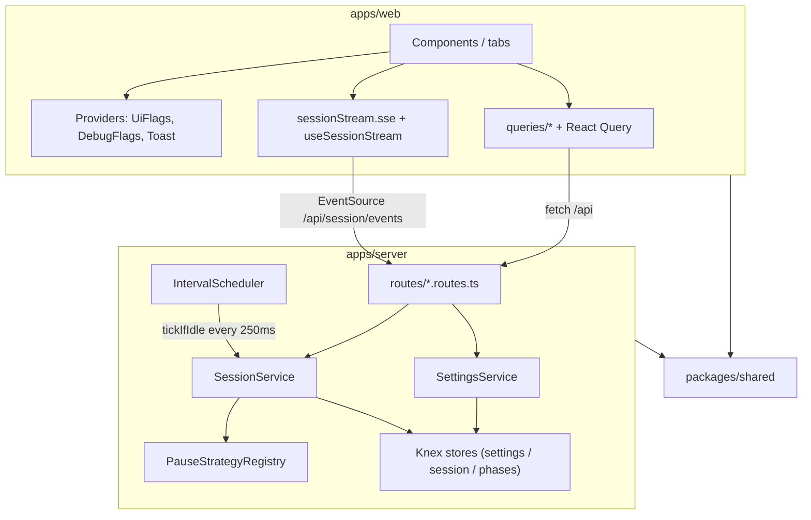
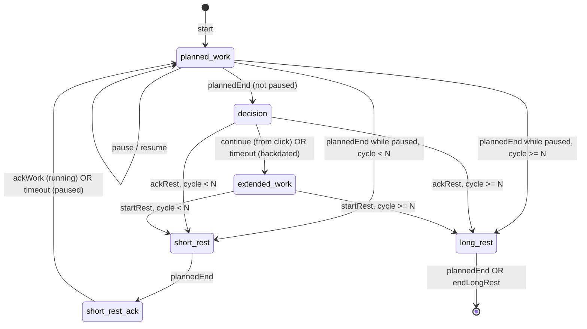

# Architecture

## Architectural style

Flexi Pomodoro is an **npm-workspace monorepo** with three packages:

| Package | Role |
|---------|------|
| `@flexi-pomodoro/shared` | Domain types, Zod schemas, `SESSION_API` path constants, debug feature catalog |
| `@flexi-pomodoro/server` | Fastify HTTP/SSE API, in-memory session engine with SQLite write-through, static web serving |
| `@flexi-pomodoro/web` | React SPA (Vite); talks to the server via REST + Server-Sent Events |

Backend style is **layered**: composition root (`app.ts`) → routes → services → pause plugins → Knex/SQLite stores. Settings load and save through `SettingsStore`. The session engine is an **in-memory state machine** advanced by wall-clock ticks (`IntervalScheduler`), with transactional write-through to `SessionStore` / `PhasesStore` on every transition. On boot, `buildApp` calls `hydrateFromStore` then one `runRecoveryTick` before the scheduler starts; corrupt runtime abandons to idle with a user-visible notice. Pause policy is injected as a `WorkPauseStrategy` plugin, not inlined in the engine.

Frontend style is **feature-oriented folders** under `apps/web/src`: components (by tab/feature), providers, queries (API + React Query hooks), hooks (SSE stream), utils, `lib/`, constants. Styling is Tailwind CSS v4 + shadcn/ui (base-nova) mapped from `apps/web/DESIGN.md` (Quiet Dark). Tab switching is local React state (no client router).

## Layer diagram



## Design patterns in use

| Pattern | Where | Notes |
|---------|-------|-------|
| **Composition root / manual DI** | `apps/server/src/app.ts` `buildApp()` | Opens SQLite via `openDatabase()`, hydrates settings, builds `AnalyticsService`, hydrates session (`hydrateFromStore` → `runRecoveryTick`), registers routes, runs `finalizeDueDays` once, starts `IntervalScheduler` (session tick + client-day rollover finalize); returns `{ app }` |
| **Repository / store** | `db/stores/*` | Purpose-split Knex stores; settings + session/phase write-through; analytics overlapping reads + `daily_stats`; session/phase reads for boot hydrate |
| **Service layer** | `SettingsService`, `SessionService`, `AnalyticsService` | Business rules and state; routes stay thin |
| **Observer / pub-sub** | `SessionService.subscribe` / `notify` | SSE clients receive snapshot deltas |
| **Strategy (scheduler interface)** | `Scheduler` + `IntervalScheduler` | Comment in `scheduler.ts`: swap for deadline-based scheduler later; `onTick` may return a Promise |
| **Mutex / skip-if-busy** | `AsyncMutex` in `SessionService` | Commands use `runExclusive`; scheduler uses `tickIfIdle` → `tryRunExclusive` so intervals do not queue behind a long command |
| **Strategy (pause plugins)** | `PauseStrategyRegistry` + `WorkPauseStrategy` | Engine calls `onPause` / `onResume` / `isCountdownFrozen` / `onPlannedEnd`; default registry registers `soft` and `hard` |
| **Catalog / plugin registration** | `DEBUG_SERVER_FEATURES` in `packages/shared/src/debug/catalog.ts` | Server debug features register id + optional `applyBounds`; web labels live in `browserFlags/debug/` |
| **Browser flag stores** | `createFlagCatalog` + `createFlagStore` in `apps/web/src/browserFlags/` | Shared localStorage-backed stores for debug flags (gated) and UI preferences (ungated) |
| **Schema-driven validation** | Zod in shared + server | Shared exports type-source schemas; server `settingsValidation.ts` parses HTTP bodies |
| **Watermark / cursor** | Server `listenerCursors` + client `AlertSeqStore` | Alert delivery is delta-only via `sinceSeq` |
| **SPA fallback** | `app.setNotFoundHandler` | Non-API 404s serve `index.html` when `WEB_DIST` exists |

## Inversion of control / DI

No DI container. Wiring is explicit:

```typescript
// apps/server/src/app.ts
const { db, stores } = await openDatabase();
const settings = new SettingsService(stores.settings);
await settings.hydrate();
const analytics = new AnalyticsService(stores.analytics, settings);
const session = new SessionService({
  session: stores.session,
  phases: stores.phases,
});
try {
  await session.hydrateFromStore();
  await session.runRecoveryTick(Date.now());
} catch (error) {
  // CORRUPT_RUNTIME → abandonCorruptRuntime (idle + notice)
}
await registerRoutes(app, { settings, session, analytics });
await analytics.finalizeDueDays();
let lastSeenClientDate = clientDateAt(Date.now(), settings.get().timezone);
const scheduler = new IntervalScheduler({
  intervalMs: 250,
  onTick: async (nowMs) => {
    await session.tickIfIdle(nowMs, true);
    const clientDate = clientDateAt(nowMs, settings.get().timezone);
    if (clientDate === lastSeenClientDate) return;
    lastSeenClientDate = clientDate;
    await analytics.finalizeDueDays();
  },
});
// onClose: scheduler.stop(); await db.destroy();
```

On the web, React Context provides `UiFlagsProvider`, `DebugFlagsProvider` (both from `browserFlags/`), and `ToastProvider`; TanStack `QueryClientProvider` wraps the tree in `main.tsx`.

## Cross-cutting concerns

| Concern | Implementation |
|---------|----------------|
| Logging | Fastify `{ logger: true }` |
| Validation | Zod (`SessionParamsSchema` / `SettingsSchema` in shared; `SettingsPatchSchema` / `parseStartSessionBody` / `mergeSessionParams` in server `settingsValidation.ts`; `parseDebugFlags` in shared) |
| Error mapping | Shared `errorReply` in `apps/server/src/utils/errorReply.ts` → HTTP 400/403/409 + `{ error, code }` |
| Auth / rate limit / tracing | Not found in committed history |
| Static assets | `@fastify/static` when web dist is discoverable |
| Real-time | SSE with 25s heartbeat comments; client also polls every 5 minutes and on focus/visibility |

## Backend request lifecycle

1. **Entry** — `apps/server/src/index.ts` reads `PORT` / `HOST`, calls `buildApp()`, `listen`.
2. **App** — `openDatabase()` + settings hydrate; `session.hydrateFromStore()` + one `runRecoveryTick` (or `abandonCorruptRuntime` on `CORRUPT_RUNTIME`); Fastify instance; services + routes + scheduler; optional static hosting; `onClose` destroys Knex.
3. **Route** — e.g. `POST /api/session/start` parses body via server `parseStartSessionBody`, resolves params via `settings.resolveSessionParams`, `await`s `session.start` (and other session mutations). Settings PUT `await`s `settings.update` (SQLite write-through).
4. **Service** — under `AsyncMutex.runExclusive`, mutates in-memory session and writes phase/session rows in a Knex transaction; mutating commands call `tickUnlocked` first via `beginActiveCommand`; `notify()` pushes snapshots to SSE subscribers. `getSnapshot` / SSE open are pure reads (no catch-up).
5. **Tick** — every 250ms `session.tickIfIdle(nowMs, true)` advances due phase boundaries when the mutex is free; overlapping intervals skip instead of queuing.

Settings use SQLite (singleton row). Active session state is served from process memory after boot hydrate; every transition also write-throughs to `sessions` / `session_runtime` / phase tables. Container recreate with a surviving `/data` volume resumes mid-session via hydrate + recovery.

## Session phase state machine



`N` is `cyclesBeforeLongRest`. Rest kind is chosen by `cycleIndex >= N` → long rest, else short rest.

Short rest ends enter `short_rest_ack` (not running work). Explicit `ackWork` starts the next cycle running; ack timeout emits `short_rest_ack_expired` and starts the next cycle immediately paused via the active pause strategy. Snapshots include `liveStats` with in-phase progress at `serverNow`; the web HUD extrapolates locally via `liveStatsAt()` and `ActiveTimer`'s `useNow` tick.

Decision timeout attributes elapsed decision time to **extended work** (`startedAt` = decision start). Explicit **continue** starts extended work at the click time (decision elapsed excluded). Soft pause through planned end **skips decision** and enters rest at planned end (`onPlannedEnd` → `"rest"`). While a strategy reports `isCountdownFrozen`, planned-end ticks are skipped.

## Pause plugins

Pause behavior lives under `apps/server/src/pause/`, not inline in the session engine.

| Piece | Role |
|-------|------|
| `WorkPauseStrategy` | Plugin contract: `id`, `onPause`, `onResume`, `isCountdownFrozen`, `onPlannedEnd` |
| `PauseStrategyRegistry` | Lookup by strategy id; constructor registers plugins for this process |
| `defaultPauseRegistry()` | Production table: `softPauseStrategy` + `hardPauseStrategy` |
| `softPauseStrategy` | Countdown keeps running; `plannedEndAt` unchanged; still-paused at planned end → auto-rest |
| `hardPauseStrategy` | Countdown frozen via `timerFrozenAt`; `plannedEndAt` shifts on resume; planned end → decision |

`SessionService` resolves `pausePlugin` at `start` from the registry using `settings.workPauseStrategy` (passed from the start route) and clears it when the session completes. HTTP is strategy-agnostic: `POST /api/session/pause` and `POST /api/session/resume`.

## Frontend architecture

### Component hierarchy

```
main.tsx
  QueryClientProvider
    UiFlagsProvider
      DebugFlagsProvider
        ToastProvider
          App (header Logo + title)
          Nav
          TimerTab | SettingsTab | AnalyticsStub | AboutTab
            TimerTab → IdleStartForm | ActiveTimer
              ActiveTimer / IdleStartForm → TimerDial (default) or classic clock
            AboutTab → Logo, AboutAccordion, LinkCard, AboutIcon
            Shared primitives → components/ui/* (shadcn)
```

### Smart vs presentational

| Kind | Examples |
|------|----------|
| Container / smart | `App` (queries + stream + mutations), `SettingsTab` (draft + browser prefs + debug), `AboutTab` (health + clipboard), `useSessionStream` |
| Presentational | `Nav`, `NumberField`, `Logo`, `LinkCard`, `AboutAccordion`, `TimerDial`, `ActiveTimer` (receives `ActiveSnapshot`; owns its own `useNow` tick) |

### Routing

No React Router. `App` holds `tab: "timer" | "settings" | "analytics" | "about"` and conditionally renders panels.

### Real-time / countdown

- **Authoritative phase changes**: SSE (`/api/session/events`) + hybrid poll fallback (`sessionStream.sse.ts`).
- **UI countdown**: each leaf owns its clock. `ActiveTimer` uses `useNow(ACTIVE_UI_TICK_MS)` (250ms) for remaining/overtime from ISO anchors — no sub-second API polling. Hard pause uses `timerFrozenAt` as the clock anchor while paused. Shared `phaseClock` helpers (`phaseEndAt` / `phaseDurationSec` / `phaseClockMs`) back both dial and classic layouts. `IdleStartForm` uses `useNow(IDLE_ESTIMATE_TICK_MS)` (60s) only for the absolute estimated-end label.
- **Timer dial (default)**: `TimerDial` renders a countdown arc (`dialProgress`), overtime comet, cycle dots (`cycleDotStates`), and Cycle / Phase ends / Estimated end readouts. Idle shows a still full ring. Opt out with the `classicTimer` UI flag to keep the plain clock.
- **Estimated session end**: idle shows locale wall-clock end plus approximate duration (`sessionProjection` — nominal path: `N×work + (N−1)×short rest + long rest`, no decision windows). Active shows a live end time via `activeEstimatedSessionEndMs` (forward remainder from current phase anchors; deliberation, extended work, and hard-pause slip shift the projection).
- **Live stats HUD**: `ActiveTimer` shows Worked / Deliberation / Rest / Paused counters formatted with `formatHhMmSs` (`mm:ss` under one hour, `hh:mm:ss` after). `liveStatsAt(snapshot, now)` strips in-phase progress at `serverNow` and re-adds at local `now`. Worked/paused formulas use shared `plannedWorkSecAt` / `pausedSecAt`. While planned work is paused, the client freezes **worked** at pause start (`timerFrozenAt ?? pauseStartedAt`); **paused** keeps advancing on the wall clock (soft and hard).
- **Browser preferences**: `classicTimer` and `hideContinueButton` UI flags (localStorage `flexi-pomodoro:uiFlags`). Classic timer swaps dial for plain clock; hide Continue omits that action during the work-decision phase.
- **Brand assets**: `public/logo.svg` (plus raster favicons) via `Logo`; header and About use it. About credits Quiet Dark from flavors.design.
- **Corrupt-runtime notice**: idle snapshots may include `recoveryAbandonedMessage`; `IdleStartForm` shows it until the next successful start.
- **Pause actions**: planned-work buttons call `SESSION_API.pause` / `SESSION_API.resume`. Label and phase suffix follow the locked session strategy (`Soft pause` vs `Hard pause (experimental)`). Toasts mirror the same strategy.
- **Settings**: Experimental features gate exposes **Enable hard pause (experimental)**; unchecked maps to `workPauseStrategy: "soft"`, checked to `"hard"`. Searchable IANA timezone combobox persists `settings.timezone` for analytics day bounds. Saved with **Save defaults**; locked while a session is active. On first successful settings load, `useSeedTimezone` may `PUT` the browser zone once when the stored value is still install-default `UTC` (gate: `flexi-pomodoro:tzSeeded`).

### Code splitting

Not found in committed history (no `React.lazy` / dynamic import of routes).

## Alert delivery model

1. Server appends `{ seq, id }` to an alert log on transitions.
2. Snapshots include `pendingAlerts` filtered by client `sinceSeq`.
3. Client `playAlerts` maps each `AlertId` to `public/alerts/placeholder-<id>.wav` (including `short_rest_ack_expired`) and plays unplayed deltas; `AlertSeqStore` persists the watermark in `localStorage` (`flexi-pomodoro:lastPlayedAlertSeq`).
4. On idle after active, client `syncAlertSeq()` aligns with server high-water and may reset history server-side after session end.

## Persistence

| Data | Status |
|------|--------|
| Settings | SQLite singleton via `SettingsStore` (`flexi-pomodoro.sqlite3` under `DATA_DIR`); includes IANA `timezone` |
| Session / phases | Write-through via `SessionStore` / `PhasesStore` (transactions on start, pause, phase transitions, complete); FR-FLOW-11 deletes decision on timeout; pause_slices + planned_work pause columns |
| Analytics day rolls | `AnalyticsStore` + `AnalyticsService` overlap-clip closed phases for a client-timezone day; `GET /api/analytics/today` serves open-day totals; `finalizeDueDays` runs at boot and when the scheduler observes a client-date change |
| Boot resume | `hydrateFromStore` rebuilds `ActiveSession` (incl. `alertSeq` + open pause); one `runRecoveryTick` closes overdue phases with `endedReason: "recovery"`; `CORRUPT_RUNTIME` → `abandonCorruptRuntime` (`interrupted`, clear runtime, idle notice) |
| Schema | Knex migrations `20260909134105_initial_schema`, `20261109143000_settings_timezone`, `20261109180000_daily_stats` |
| Debug prefs | Browser `localStorage` (`flexi-pomodoro:debugFlags`) — client-only |
| UI prefs | Browser `localStorage` (`flexi-pomodoro:uiFlags`) — client-only |
| Timezone seed gate | Browser `localStorage` (`flexi-pomodoro:tzSeeded`) — client-only; one-shot browser IANA seed |
| Alert watermark | Browser `localStorage` — client-only |
| Docker volume `/data` | Mounted; `DATA_DIR=/data` in compose; image runs as `USER node` with `/data` owned by `node` (FPMD-2) |
